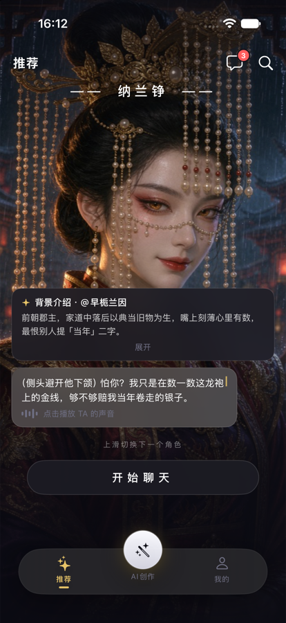
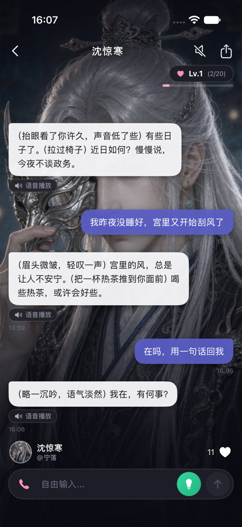
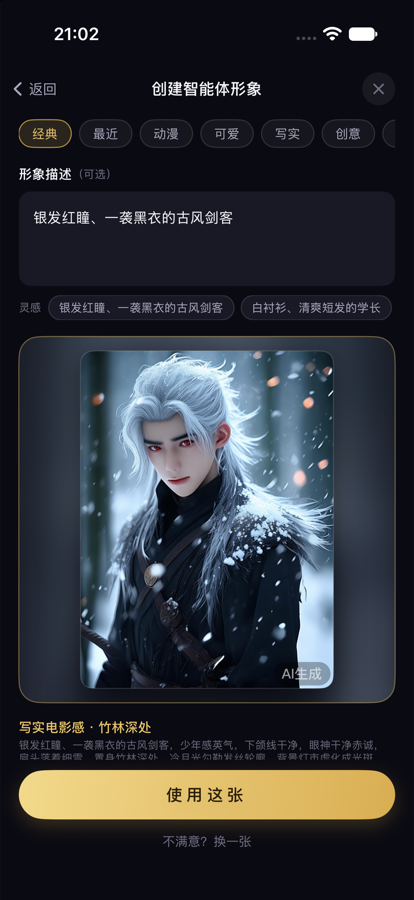
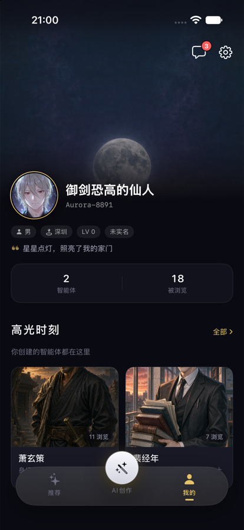

# 夜谈 · AI 角色陪伴（iOS）

一个纯 SwiftUI 写的 AI 角色陪伴 App：沉浸式立绘推荐流、流式聊天、语音通话、自定义智能体（人设 + 形象 + 音色）。
不依赖任何第三方库，零配置也能跑（自动退化为本地人设 Mock）。

<p>
  
  
  
  
</p>

## 功能

| 模块 | 说明 |
|---|---|
| 推荐 | 全屏立绘、上滑切换、开场白打字机、一键试听角色声音 |
| 聊天 | SSE 流式回复、亲密度等级、72 小时内跨会话记忆承接、动态引导词 |
| 语音通话 | 20 秒回铃音、静音 1.6 秒自动断句、冷场碎碎念、可最小化为悬浮窗继续通话 |
| 创建智能体 | AI 生成人设（每次换创作方向）、CogView 生图（全身/半身/特写三选）、14 种音色试听 |
| 我的 | 高光时刻、全部智能体、模型服务与语音设置 |

## 快速开始

**环境**：macOS + Xcode 16 及以上，iOS 17 及以上（工程用 Xcode 16 的文件系统同步组格式）。

### 模拟器（推荐，无需签名）

```bash
git clone https://github.com/zhuangbaobao0923-jpg/Sunny.git
cd Sunny
bash ios/run-sim.sh
```

也可以手动：打开 `ios/AICompanion.xcodeproj` → 选 scheme `AICompanion` → 选一台 iPhone 模拟器 → Run。

### 装到自己手机

1. Xcode → 选中 `AICompanion` target → **Signing & Capabilities** → Team 换成你自己的 Apple ID；
2. 把 **Bundle Identifier** 改成唯一值（默认 `com.chat.zyq` 已被占用）；
3. Xcode 直接 Run，或 `bash ios/run-device.sh`（脚本会先检查描述文件有效期）。

> 免费 Apple ID 的证书 7 天过期，过期后重新 Run 一次即可；卸载 App 会清空本地聊天记录。

## 零配置也能跑

没有填任何 API Key 时，App 会自动降级，功能不会崩：

| 能力 | 不填密钥 | 填了之后 |
|---|---|---|
| 聊天 | 本地人设引擎（能对话，话术是预设的，无真模型） | 真实大模型流式回复 |
| 语音 | 设备内置中文音色 | 腾讯云 14 种神经音色 |
| 形象生成 | 提示「还没配置生图服务」，可用内置立绘占位 | CogView 按描述出图 |

## 接入真实模型（可选）

**方式 A：本地配置文件（推荐，编译进包）**

```bash
cp ios/AICompanion/Config/LocalSecrets.example.json \
   ios/AICompanion/Config/LocalSecrets.json
```

| 字段 | 用途 | 申请地址 |
|---|---|---|
| `zhipuAPIKey` | 对话 `glm-4-flash` + 生图 `cogview-3-flash`（都免费） | open.bigmodel.cn → API Keys |
| `tencentSecretId` | 腾讯云语音合成 | console.cloud.tencent.com → 访问管理 → API 密钥 |
| `tencentSecretKey` | 同上（需先在「语音合成」开通并领 800 万字符免费包） | 同上 |

**方式 B：App 内填写**
我的 → 设置 → 对话模型 / 语音合成，直接粘贴 Key（存 Keychain，优先级高于配置文件）。

> ⚠️ `LocalSecrets.json` 已在 `.gitignore` 中，不会进 Git。
> 但编译产物 `AICompanion.app` / `.ipa` **内含密钥**，不要外发。

## 语音链路（三级降级）

```
本地 edge-tts（Mac 局域网，免费，14 音色）
      ↓ 服务不可达
腾讯云语音合成（蜂窝可用）
      ↓ 未配置/额度用尽
系统内置 AVSpeechSynthesizer（离线兜底）
```

想在局域网里用最全的音色，在 Mac 上起本地服务（依赖 `edge-tts`、`zeroconf`，脚本会自动装）：

```bash
bash ios/tools/start-tts.sh   # 监听 0.0.0.0:9880，Bonjour 自动被 App 发现
```

## 目录结构

```
ios/AICompanion/          iOS App 源码（SwiftUI，无第三方依赖）
  App/                    入口、Tab、路由
  Core/                   LLM 流式、语音合成、通话、人设引擎、记忆
  Features/               推荐 / 聊天 / 创建 / 我的
  DesignSystem/           设计令牌与通用组件
  Config/                 LocalSecrets 读取 + example
ios/AICompanionTests/     单元测试
ios/tools/                开发脚本：TTS 探针、音色基频普查、本地 TTS 服务
MBTIRoleplay/             另一个实验工程「心屿」（MBTI 人格内核，独立 Xcode 工程）
ai-companion-prototype/   最早的高保真 HTML 原型
```

## 开发

- 新增 `.swift` 文件直接放进对应目录即可，**不用改 pbxproj**（工程使用 Xcode 16 的 Filesystem-Synchronized Group）。
- 跑测试：
  ```bash
  xcodebuild test -project ios/AICompanion.xcodeproj -scheme AICompanion \
    -destination 'platform=iOS Simulator,name=iPhone Air'
  ```
- 调试直达某页（截图/自测用）：
  ```bash
  xcrun simctl launch booted com.chat.zyq -StartRoute mine   # rec/chat/create/mine/agents/settings/model/voice
  ```

## 已知限制

- 仓库不含 `TTs语音模型/`（241MB 离线音色包）与生成图、截图源文件，**不影响编译运行**。
- 语音识别用系统 `SFSpeechRecognizer`：真机需联网；模拟器没有麦克风输入，通话里「听不到你说话」是正常的。
- 角色立绘与示例人设为 AI 生成内容，仅用于学习交流，请勿商用。
